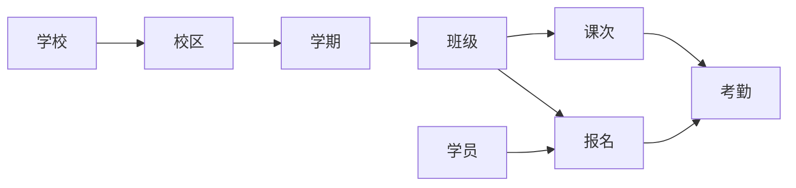
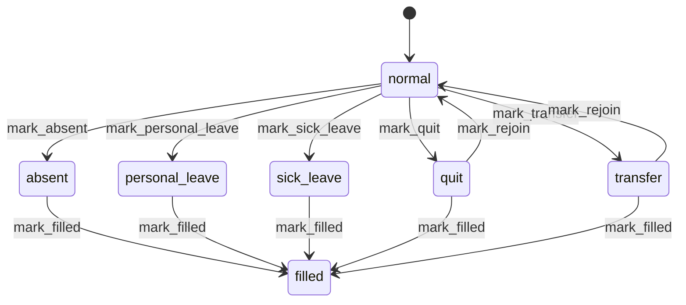

# 维拓校务管理平台

培训机构教务管理后台，管理校区、学期、班级、课次、学员报名与考勤，并提供班级经营报表。

技术栈：Rails 8.1 / Ruby 3.3.9 / MySQL / Hotwire（Turbo + Stimulus）/ Tailwind CSS v4 + daisyUI / importmap（无 JS 打包步骤）。后台作业、缓存、Action Cable 均基于生产数据库（solid_queue / solid_cache / solid_cable）。

给 AI 助手的完整架构与约定见 [AGENTS.md](AGENTS.md)。

## 快速开始

```bash
bin/setup                 # 安装依赖、准备数据库（默认随后启动 bin/dev）
bin/setup --skip-server   # 只准备环境，不启动服务
bin/dev                   # Rails + Tailwind watcher（改样式必须开着）
bin/rails test            # 全量测试
bin/rails test test/models/semester_test.rb:18   # 单个用例
bin/ci                    # 全套本地检查：rubocop / bundler-audit / importmap audit / brakeman / 测试 / seeds
```

单独检查：`bin/rubocop`、`bin/bundler-audit`、`bin/importmap audit`、`bin/brakeman`、`bin/rails tailwindcss:build`。

本地 MySQL 通过 `/tmp/mysql.sock` 以 root 免密连接，库为 `weituo_development` / `weituo_test`；`db/seeds.rb` 会生成演示数据（含 1000 名学员）。测试用 `fixtures :all`，认证用 `sign_in_as(users(:one))`。

## 角色与权限

| 角色 | `UserCampuse.role` | 可见范围 |
| --- | --- | --- |
| 超级管理员 | `admin` | 全部菜单，含用户管理、学校管理 |
| 管理员 | `manager` | 按 `grade_ids` 限定的年级与科目 |

用户通过 `UserCampuse` 关联到校区，一个用户可有多个校区授权，每个授权带一份 JSON `grade_ids`。`Current.user.grades_by_campuse` / `subjects_by_campuse` 决定筛选与表单里可选的年级、科目。

**当前上下文**：登录后 `AdminController#set_thread_current` 把当前校区、学校、学期写入 `Thread.current` 并记在 session 里；顶栏可切换校区/学期。所有列表与详情都按这三个上下文过滤，切换后看到的是另一套数据。学期默认取覆盖今天的学期，取不到则回退到 `seq` 最大的学期。

账号以用户名 + 密码登录（`users` 表无邮箱字段），不提供自助邮件重置密码；需要重置时由管理员在「用户管理」中修改。

## 术语与数据模型

| 业务名词 | 模型 / 表 | 说明 |
| --- | --- | --- |
| 学校 | `School` / `schools` | 顶层组织 |
| 校区 | `Campuse` / `campuses` | 模型名是刻意的单数拼写，勿改 |
| 学期 | `Semester` / `semesters` | 按 `seq` 排序，带 `start_date` / `end_date` |
| 年级、科目 | `Grade` / `Subject` / `GradeSubject` | 学校可开设的年级科目组合 |
| 日校 | `DaySchool` | 学员就读的全日制学校 |
| 教师 | `Teacher` | 属于校区，带科目 |
| 学员、监护人 | `Student` / `Guardian` | 属于校区，可带年级、日校 |
| 班级 | `SemesterKlass` / `semester_klasses` | 学期 + 校区 + 年级 + 科目 + 班型 + 序号 |
| 课次 | `Course` / `courses` | 班级下按 `seq` 排列的一节课，有 `start_date` 表示已开课 |
| 报名 | `KlassStudent` / `klass_students` | 学员与班级的关系，状态 `in` / `out` / `transfer` |
| 考勤 | `Attendance` / `attendances` | 每个「课次 × 报名」一条记录 |
| 用户、授权、会话 | `User` / `UserCampuse` / `Session` | 登录与权限 |

`klasses` 表仍存在于 schema，但没有对应模型，也不参与现有流程。



## 核心业务流程

### 1. 开班

入口：`班级管理 → 开班`，或 `POST /admin/semester_klasses`。

- 必填：学期、年级、教师、校区、班型（`TG` 提高 / `JY` 精英 / `XZ` 创新 / `XQ` 兴趣 / `CC` 超常）、序号、`times`（课次数）
- **科目由教师带出**，不由表单单独指定
- 唯一性：`学期 + 校区 + 年级 + 科目 + 班型 + 序号` 不可重复
- 创建后 `after_create` 自动生成 `times` 门课次（`seq` 从 1 开始，均无 `start_date`）
- 班级名规则：`年级 level + 科目首字 + 班型中文首字 + 序号`，例如 `7数提1`

### 2. 学员报名与批量导入

`Student#join_klass(semester_klass, course_seq: 1)` 要求学员的年级、校区与班级一致；不匹配直接跳过。

- 从第 1 课入班：仅为**已开课**的课次生成考勤
- 插班（从第 N 课入班）：第 N 课之前的课次补记为 `absent`，第 N 课及之后已开课的课次生成 `normal` 考勤
- 文本导入按行解析，每行 `姓名` 或 `姓名 N+`（`+` 表示插班到第 N 课）；姓名不存在、年级不符的行会被跳过
- 班级页「添加学员」按钮（`insert_students`）会自动给每行追加「当前课次 +」，用于按课次插班

学员还支持按 CSV 文本批量建档（`Student.add_by_text`）：`姓名,性别,生日,年级level,层级,入学日期,日校`；年级或日校匹配不到则跳过。教师、日校、监护人也有各自的 `add_by_text` 文本导入。学员列表按 30 条/页分页，可按姓名、年级筛选，并按「在班 / 未入班 / 有退课」分栏。

### 3. 开课与考勤生成

`PUT /admin/semester_klasses/:id/courses/:id/start` → `Course#start!`：

- 写入 `start_date`（默认今天），已开课则直接返回（幂等）
- 为该班级**所有报名学员**生成 `Attendance`，初始状态 `normal`
- 班级所有课次都有 `start_date` 时，`SemesterKlass#ended?` 为 true（结课）

班级详情页以「学员 × 课次」矩阵展示考勤，未开课的课次显示「未开课」。

### 4. 考勤状态流转

状态：`normal` 正常、`absent` 缺课、`filled` 补课销假、`personal_leave` 事假、`sick_leave` 病假、`quit` 退课、`transfer` 转出。每次打标会在 `mark_at` 里记对应时间戳。

| 事件 | 允许从 | 到 | 额外副作用 |
| --- | --- | --- | --- |
| `mark_absent` | `normal` / `filled` | `absent` | 记 `absent_at` |
| `mark_personal_leave` | `absent` / `normal` / `filled` | `personal_leave` | 记 `personal_leave_at`，**要求课次已开课** |
| `mark_sick_leave` | `absent` / `normal` / `filled` | `sick_leave` | 记 `sick_leave_at` |
| `mark_filled` | `absent` / `personal_leave` / `sick_leave` / `quit` / `transfer` | `filled` | 清空各类请假/退课时间戳 |
| `mark_quit` | `absent` / `normal` / `personal_leave` / `sick_leave` / `filled` / `transfer` | `quit` | 级联后续课次 + 报名转 `out` |
| `mark_transfer` | `absent` / `normal` / `personal_leave` / `sick_leave` / `quit` / `filled` | `transfer` | 级联后续课次 + 报名转 `transfer` |
| `mark_rejoin` | `quit` / `transfer` | `normal` | 当前及后续课次恢复 `normal` |

打标入口是 `PUT /admin/semester_klasses/:sk_id/courses/:course_id/attendances/:id/mark?status=...`，控制器按白名单分派 `mark_*!`，未知 status 会被忽略。



### 5. 退课 / 转出的级联

在某课次标记 `quit` 或 `transfer` 时，不只是改这一条考勤：

- **后续所有课次**（`seq > 当前课次`）自动生成/更新考勤为 `quit` 或 `transfer`
- 对应的 `KlassStudent` 转为 `out`（退班）或 `transfer`（转出）
- 之后对该学员执行 `mark_rejoin`，当前及后续课次恢复 `normal`

`KlassStudent` 自身状态机：`in`（初始）→ `out` / `transfer`，`transfer` 与 `out` 之间可互相转换。

### 6. 班级报表

入口：`班级报表`（`GET /admin/semester_klasses/statement`），可按学期、年级、科目、教师、班型筛选，展示班级人数与三个比率。分母均为**当前在班学员数**。

| 指标 | 口径（以代码为准） |
| --- | --- |
| 新增率 `new_rate` | 当前在班学员中，未出现在**历史学期**（`seq` 更小且开学更早）任何班级的占比 |
| 拓科率 `expand_rate` | 当前在班学员中，**上学期读过其他科目但未读过本科目**的占比 |
| 预留率 `reserve_rate` | 当前在班学员中，**下学期同科目班级**仍就读的占比 |

> 注：`SemesterKlass#reserve_students` 的注释写的是「上学期」，实现用的是 `related_next_semester`（下学期），以上表为准。

页面顶部还有 4 个汇总卡：统计班级数、在班学员人次、平均新增率、平均预留率。

### 7. 复制历史班级

入口：`复制历史班级`（`/admin/semester_klasses/copy`），只能选 seq 小于当前学期的历史班级。

复制时按新表单重新生成班级：**归属当前学期与当前校区**、科目由所选教师带出、按 `times` 重建课次，并按 `students_text` 重新导入学员。**不会**把源班级的报名关系带过来。

### 8. 学期 / 校区切换

顶栏下拉切换后写入 session 与 `Thread.current`；班级列表、班级详情、报表等都随之切换作用域。切换学期时若目标学期的班级不在当前上下文中，详情会打不开——先切换学期再进入对应班级。

## 页面入口

| 路径 | 用途 |
| --- | --- |
| `/` | 学员管理（首页） |
| `/admin/semester_klasses` | 班级管理 |
| `/admin/semester_klasses/statement` | 班级报表 |
| `/admin/semester_klasses/copy` | 复制历史班级 |
| `/admin/teachers` | 教师管理 |
| `/admin/users` | 用户管理 |
| `/admin/schools` | 学校管理（含校区、学期、年级科目维护） |
| `/session/new` | 登录 |

除登录、密码相关页面与 `/up` 健康检查外，所有页面都要求登录。

## 测试

- `test/models/`：模型与状态机、报表口径、批量导入
- `test/controllers/`：各控制器 action 的功能测试（含鉴权、失败路径、副作用断言）
- `test/integration/`：重点业务场景端到端流程——班级全生命周期、跨学期报表、学期/校区切换与权限作用域

`bin/ci` 会跑完 rubocop、bundler-audit、importmap audit、brakeman、测试与 test 环境 `db:seed:replant`，与 CI 一致。

## 部署

Kamal，配置见 `config/deploy.yml`；生产使用 4 个 MySQL 库（主库 + cache / queue / cable），连接串由 `*_DATABASE_URL` secrets 提供，后三者通过 `config/database.yml` 的 `migrations_paths` 各自管理迁移（这些目录当前尚未在仓库中创建）。Solid Queue 跑在 Puma 进程内（`SOLID_QUEUE_IN_PUMA`）。

CI/CD：`.github/workflows/ci.yml` 在 PR 和 push `main` 时跑 `bin/ci`；`.github/workflows/cd.yml` 由 **CI 在 main 上成功完成后**触发 `kamal redeploy`，并固定签出 CI 验证过的那个 commit。推送 `main` 会触发部署，请谨慎。

镜像仓库为阿里云 ACR 个人版，不接受 OCI attestation manifest，因此 `config/deploy.yml` 关闭了 buildx 的 `provenance` / `sbom`。
